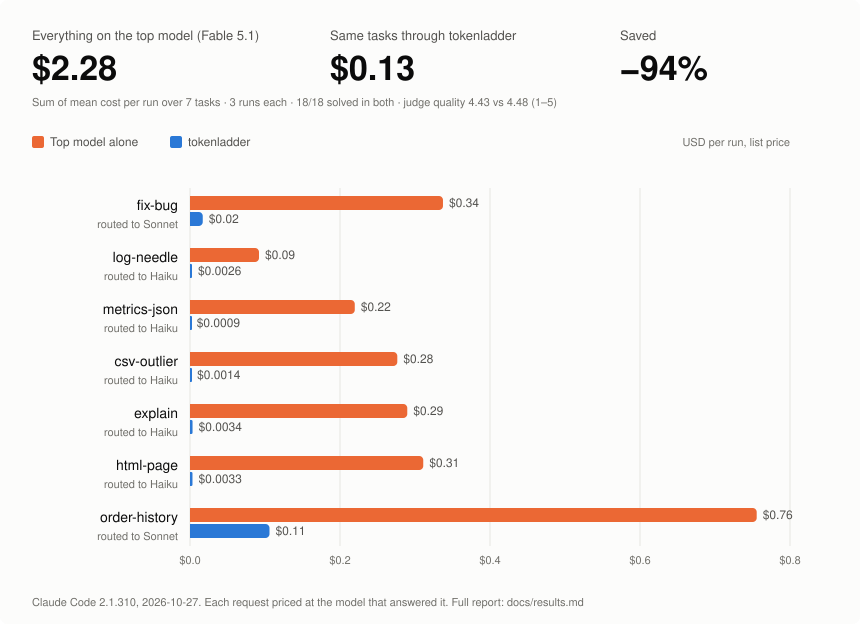

# tokenladder

**Stop paying top-model prices for bottom-model work.**

tokenladder is a local proxy that sits between your coding agent and the model provider. It reads what you asked for, sends it to the cheapest model that can do it, and trims the tool output the agent feeds back to the model. Ask for a simple HTML page while your agent runs on the most expensive model, and tokenladder serves it with a small one, so you pay small-model prices.

[](https://www.npmjs.com/package/tokenladder)

No dependencies. Node 20 or newer. Your API key or login passes through unchanged.



## Results

Same seven coding tasks, three runs each, Claude Code 2.1.310, list prices:

| | solved | cost | context read | quality (LLM judge, 1–5) |
|---|---|---|---|---|
| Everything on the top model | 18/18 | $2.28 | 637K tokens | 4.43 |
| Cheap model picked by hand | 18/18 | $0.18 (−92%) | +27% | 4.57 |
| **tokenladder** | **18/18** | **$0.13 (−94%)** | **−33%** | **4.48** |

What the numbers say:

- **Most of the dollar saving comes from the model choice.** The router is what picks it, per request.
- **The proxy's filters matter for context, not dollars.** Cheaper models take more steps and re-read more, so a cheap model alone reads 27% more than the top model. tokenladder brings that to 33% less. On a subscription plan, context is what eats your usage limit.
- **Quality held.** The three arms are within the judge's noise. The one consistent loss is a small model ignoring "start your reply with the order id", and it happens with or without the proxy.

Full report, per task: [docs/results.md](https://github.com/igorosena/tokenladder/blob/main/docs/results.md).

## How it works

```
agent ──► tokenladder (127.0.0.1) ──► provider API
             │ 1. router: which rung does this request need?
             │ 2. rewrite model, effort, cache TTL, tool list for that rung
             │ 3. compress large tool outputs (logs, JSON, CSV, test output, grep)
             └ 4. log the usage the provider returned → ~/.tokenladder/usage.jsonl
```

### The ladder

The router reads the first prompt of a session and picks a rung. Each rung is the smallest model that handles that kind of work:

| rung | model | for |
|---|---|---|
| `lookup` | Haiku, low effort, basic tools | questions, explanations, run-and-report, small things from scratch (an HTML page, a script) |
| `edit` | Sonnet, medium effort, basic tools | a bounded change: a bug an error points at, a small feature, a rename |
| `build` | Sonnet, high effort, all tools | a well-defined feature across several files |
| `open` | the model you launched with | unknown causes, performance, design decisions, security review |

When the router is unsure (confidence under 0.75), it goes one rung up, never down. A big task sent to a small model is the expensive mistake.

### The router

Two backends:

- **Jev** (recommended): a classifier from [TypeSafe](https://console.typesafe.ai). It returns a calibrated probability per rung, which is what makes the "unsure, go up" rule work. It got **96 of 100** realistic prompts right in our eval, in about 300 ms, for a fraction of a cent per session.
- **Rules**: regular expressions, no network, no key. 87 of 100. It is also the fallback when Jev fails.

### Compression

Large tool outputs are condensed before they reach the model: the error lines of a log, the outlier rows of a CSV, the hot host in a JSON dump, the failures in test output. Every omission leaves a marker saying what was kept.

Two rules the compressor never breaks:

- **Deterministic.** The same input always compresses to the same bytes, so the provider's prompt cache keeps working.
- **Code the agent will edit is never touched.** The output of the agent's file-read tool passes through exactly.

## Install

```bash
npm install -g tokenladder
```

Or from a clone, to change the code:

```bash
git clone https://github.com/igorosena/tokenladder.git
cd tokenladder
npm link        # installs the `tokenladder` command
```

## Setup: Jev key

Get a key at [console.typesafe.ai](https://console.typesafe.ai). It is self-serve with a prepaid balance. Then put it in a `.env` file in the project folder, or export it:

```bash
cp .env.example .env
# edit .env: TYPESAFE_API_KEY=...
```

Without a key, use `--route rules`. It works, just with less accurate routing.

## Usage

```bash
tokenladder claude --route jev          # open Claude Code through the proxy; it picks the rung
tokenladder claude --profile lookup     # force one rung
tokenladder claude --mode passthrough   # measure only, change nothing
tokenladder stats --by session          # what each session cost and which rung it used
tokenladder route "add a test for the empty cart case"   # which rung would this go to?
```

Keep it running for any client:

```bash
tokenladder start --route jev
export ANTHROPIC_BASE_URL=http://127.0.0.1:8787       # Claude Code
export OPENAI_BASE_URL=http://127.0.0.1:8787/v1       # OpenAI-compatible clients
```

In the Claude Code VS Code extension, add `{ "env": { "ANTHROPIC_BASE_URL": "http://127.0.0.1:8787" } }` to `~/.claude/settings.json`. If the proxy is not running, Claude Code stops working; remove the line to go back.

## Providers and models

| | status |
|---|---|
| **Claude Code** (Anthropic API key or Pro/Max login) | Tested end to end: 63 real runs in the last benchmark, plus earlier rounds. |
| **Codex CLI** (OpenAI Responses) | One real run so far: csv-outlier on gpt-6-astra, compression only. Weighted tokens −47%, 96% of the tool output cut, correct answer. Model routing is not set up for OpenAI models yet. |
| **OpenAI Chat Completions** | Implemented and covered by tests against a simulated server. |
| **Gemini and other providers** | Not supported yet. |

The ladder is just configuration. To try other models, edit the rungs in `src/profiles.js`, or pass a spec:

```bash
tokenladder claude --profile model=claude-sonnet-5-5+effort=low+compress+terse
```

Then measure it on your own tasks with the benchmark below. Prices per model live in `src/usage.js`; update them when providers change prices or ship new models.

## Benchmark it yourself

The benchmark runs the same tasks through each variant and reports solved, context, output, cost and, with `--judge`, quality:

```bash
tokenladder bench --tasks html-page --runs 1                      # cheap check
tokenladder bench --model fable --variants passthrough,direct,route --runs 3 --fresh-output --judge
tokenladder route-eval                                            # router accuracy on 100 labeled prompts (cents)
```

The benchmark spends real tokens. Start with one task and one run. It runs the agent with permissions skipped, but only inside a temporary copy of a small fixture project.

## License

[PolyForm Internal Use 1.0.0](https://github.com/igorosena/tokenladder/blob/main/LICENSE). You may use tokenladder and change it for your own and your company's internal use. You may not redistribute it or publish copies. For anything else, ask.

Português: [README.pt-BR.md](https://github.com/igorosena/tokenladder/blob/main/README.pt-BR.md)
