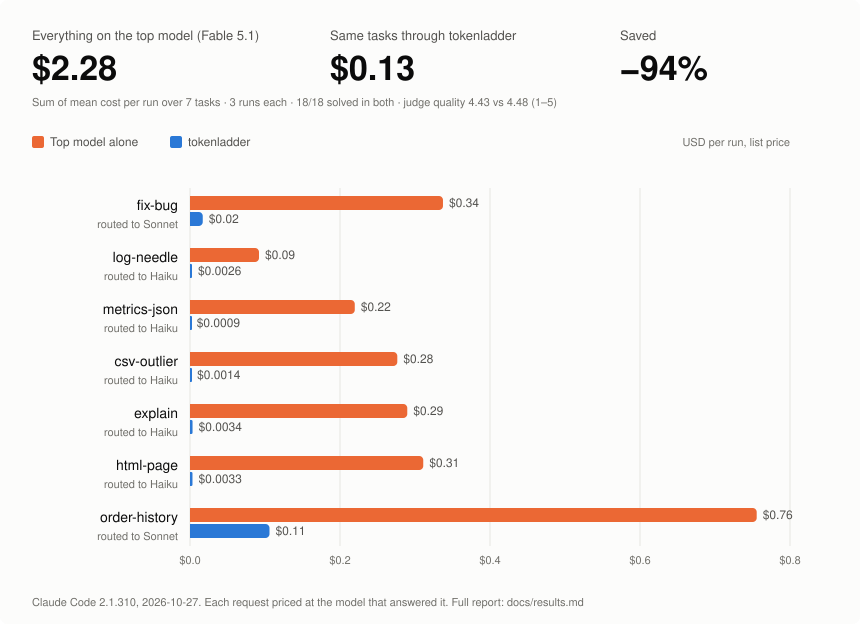

# tokenladder

**Pare de pagar preço de modelo topo de linha por trabalho de modelo básico.**

O tokenladder é um proxy local que fica entre o seu agente de código e o provedor do modelo. Ele lê o que você pediu, manda para o modelo mais barato que dá conta e enxuga a saída das ferramentas que o agente devolve ao modelo. Se você pede uma página HTML simples com o agente aberto no modelo mais caro, o tokenladder atende com um modelo pequeno, e você paga preço de modelo pequeno.

Sem dependências. Node 20 ou mais novo. Sua chave de API ou seu login passam sem alteração.



## Resultados

As mesmas sete tarefas de código, três execuções cada, Claude Code 2.1.310, preço de tabela:

| | resolvidas | custo | contexto lido | qualidade (juiz LLM, 1–5) |
|---|---|---|---|---|
| Tudo no modelo topo | 18/18 | $2,28 | 637K tokens | 4,43 |
| Modelo barato escolhido à mão | 18/18 | $0,18 (−92%) | +27% | 4,57 |
| **tokenladder** | **18/18** | **$0,13 (−94%)** | **−33%** | **4,48** |

O que os números dizem:

- **Quase toda a economia em dólar vem da escolha do modelo.** É o roteador que faz essa escolha, a cada pedido.
- **Os filtros do proxy pesam no contexto, não no dólar.** Modelos baratos dão mais passos e releem mais, então um modelo barato sozinho lê 27% a mais que o topo. O tokenladder leva isso para 33% a menos. Em plano de assinatura, é o contexto que consome o seu limite de uso.
- **A qualidade se manteve.** Os três braços ficam dentro do ruído do juiz. A única perda consistente é o modelo pequeno ignorar "comece a resposta com o id do pedido", e isso acontece com ou sem o proxy.

Relatório completo, por tarefa: [docs/results.md](https://github.com/igorosena/tokenladder/blob/main/docs/results.md).

## Como funciona

```
agente ──► tokenladder (127.0.0.1) ──► API do provedor
              │ 1. roteador: de qual degrau esse pedido precisa?
              │ 2. reescreve modelo, effort, TTL do cache e lista de ferramentas
              │ 3. comprime saídas grandes (logs, JSON, CSV, testes, grep)
              └ 4. registra o uso devolvido pelo provedor → ~/.tokenladder/usage.jsonl
```

### A escada

O roteador lê o primeiro prompt da sessão e escolhe um degrau. Cada degrau é o menor modelo que resolve aquele tipo de trabalho:

| degrau | modelo | para |
|---|---|---|
| `lookup` | Haiku, effort baixo, ferramentas básicas | perguntas, explicações, rodar e reportar, coisas pequenas do zero (uma página HTML, um script) |
| `edit` | Sonnet, effort médio, ferramentas básicas | mudança pontual: bug apontado por um erro, feature pequena, rename |
| `build` | Sonnet, effort alto, todas as ferramentas | feature bem definida em vários arquivos |
| `open` | o modelo com que você abriu o agente | causa desconhecida, performance, decisão de arquitetura, revisão de segurança |

Quando o roteador está em dúvida (confiança abaixo de 0,75), ele sobe um degrau, nunca desce. Tarefa grande num modelo pequeno é o erro que sai caro.

### O roteador

Dois backends:

- **Jev** (recomendado): um classificador da [TypeSafe](https://console.typesafe.ai). Ele devolve uma probabilidade calibrada por degrau, e é isso que faz a regra "na dúvida, sobe" funcionar. Acertou **96 de 100** prompts realistas na nossa avaliação, em uns 300 ms, por uma fração de centavo por sessão.
- **Regras**: expressões regulares, sem rede, sem chave. 87 de 100. Também é o plano B quando o Jev falha.

### Compressão

Saídas grandes de ferramentas são condensadas antes de chegar ao modelo: as linhas de erro de um log, as linhas fora da curva de um CSV, o host sobrecarregado num JSON, as falhas na saída de testes. Toda omissão deixa um marcador dizendo o que foi mantido.

Duas regras que o compressor nunca quebra:

- **Determinístico.** A mesma entrada sempre vira os mesmos bytes, então o cache de prompt do provedor continua valendo.
- **Código que o agente vai editar nunca é tocado.** A saída da ferramenta de leitura de arquivo passa exatamente como veio.

## Instalação

```bash
npm install -g github:igorosena/tokenladder
```

Ou a partir de um clone, para mexer no código:

```bash
git clone https://github.com/igorosena/tokenladder.git
cd tokenladder
npm link        # instala o comando `tokenladder`
```

## Configuração: chave do Jev

Crie uma chave em [console.typesafe.ai](https://console.typesafe.ai). O cadastro é na hora, com saldo pré-pago. Depois coloque a chave num arquivo `.env` na pasta do projeto, ou exporte a variável:

```bash
cp .env.example .env
# edite o .env: TYPESAFE_API_KEY=...
```

Sem chave, use `--route rules`. Funciona, só que com roteamento menos preciso.

## Uso

```bash
tokenladder claude --route jev          # abre o Claude Code pelo proxy; ele escolhe o degrau
tokenladder claude --profile lookup     # força um degrau
tokenladder claude --mode passthrough   # só mede, não muda nada
tokenladder stats --by session          # quanto cada sessão custou e em qual degrau caiu
tokenladder route "adiciona um teste pro carrinho vazio"   # pra qual degrau isso iria?
```

Deixando rodando para qualquer cliente:

```bash
tokenladder start --route jev
export ANTHROPIC_BASE_URL=http://127.0.0.1:8787       # Claude Code
export OPENAI_BASE_URL=http://127.0.0.1:8787/v1       # clientes compatíveis com OpenAI
```

Na extensão do Claude Code para VS Code, adicione `{ "env": { "ANTHROPIC_BASE_URL": "http://127.0.0.1:8787" } }` em `~/.claude/settings.json`. Se o proxy não estiver rodando, o Claude Code para de funcionar; remova a linha para voltar ao normal.

## Provedores e modelos

| | situação |
|---|---|
| **Claude Code** (chave da API Anthropic ou login Pro/Max) | Testado de ponta a ponta: 63 execuções reais na última bateria, além das rodadas anteriores. |
| **Codex CLI** (OpenAI Responses) | Uma execução real até agora: csv-outlier no gpt-6-astra, só compressão. Tokens ponderados −47%, 96% da saída da ferramenta cortada, resposta correta. O roteamento de modelos ainda não está configurado para modelos da OpenAI. |
| **OpenAI Chat Completions** | Implementado e coberto por testes contra um servidor simulado. |
| **Gemini e outros provedores** | Ainda não suportados. |

A escada é só configuração. Para testar outros modelos, edite os degraus em `src/profiles.js` ou passe um spec:

```bash
tokenladder claude --profile model=claude-sonnet-5-5+effort=low+compress+terse
```

Depois meça nas suas próprias tarefas com o benchmark abaixo. Os preços por modelo ficam em `src/usage.js`; atualize quando os provedores mudarem preços ou lançarem modelos novos.

## Faça o seu benchmark

O benchmark roda as mesmas tarefas em cada variante e mostra resolvidas, contexto, output, custo e, com `--judge`, qualidade:

```bash
tokenladder bench --tasks html-page --runs 1                      # teste barato
tokenladder bench --model fable --variants passthrough,direct,route --runs 3 --fresh-output --judge
tokenladder route-eval                                            # precisão do roteador em 100 prompts rotulados (centavos)
```

O benchmark gasta tokens de verdade. Comece com uma tarefa e uma execução. Ele roda o agente sem pedir permissões, mas só dentro de uma cópia temporária de um projeto de exemplo pequeno.

## Licença

[PolyForm Internal Use 1.0.0](https://github.com/igorosena/tokenladder/blob/main/LICENSE). Você pode usar o tokenladder e modificá-lo para uso interno seu e da sua empresa. Não pode redistribuir nem publicar cópias. Para qualquer outro uso, fale com o autor.

English: [README.md](https://github.com/igorosena/tokenladder/blob/main/README.md)
